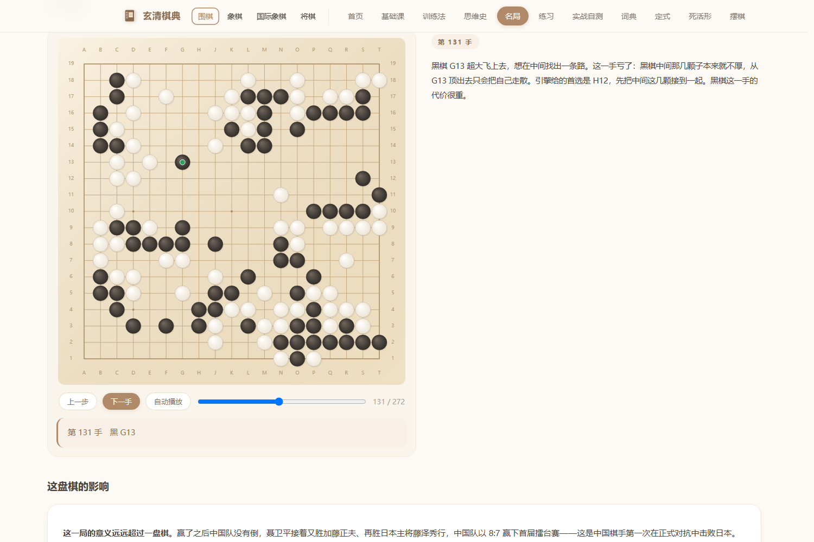

# 玄清棋典 · RapaceClassic

## ⬇️ 下载

**[Releases 页面](https://github.com/Rapace7/RapaceClassic/releases) → 拉到底 → `RapaceClassic.html`**

下完**双击**，浏览器打开就行。约 7.7 MB。

> 文件名和仓库名一致。内容全是中文，只是文件名用了英文 ——
> GitHub 会把中文附件名显示成 `default.html`。

**当前版本：v1.1**（2026-10-14）。页脚写着版本号，右键查看源码也能在头部注释里看到版本戳 ——
新旧文件打开长得一样，靠这两处区分。

**不会用 GitHub 也能拿**：打开上面那个链接 → 往下滑找到 **v1.1** →
下面 **Assets** 区块点那个文件 → 下载。不需要注册、不需要登录。

---

> **一个 HTML 文件** —— 下载、双击、用浏览器打开，就这么简单。不用装任何东西。

围棋词典：术语、定式、死活形、名局详解、基础课、实战自测。
所有题目的答案都由程序推演验证过。

---

## 里面长什么样

<!-- HTML 标签：可显式限宽（1500px 原始宽度会撑破手机屏）并居中 -->
<p align="center">
  
</p>

*名局详解 —— 聂卫平 vs 小林光一「冲天之战」，第 131 手（黑 G13）。
右边跟着这一手的解说，讲这一手为什么在中腹挺住、从 G13 顶出去扳粘；
下面还有「这盘棋的影响」——赢了之后中国队没有倒，8:7 赢下首届擂台赛。*

每一手都能逐手走，也有逐段解说与关键手标出。另有李世石 vs AlphaGo 第五局、
柯洁、李世石、申真谞的对局，以及古代与日本的经典名局。

其他板块：系统课程（34 课）· 思维史（30 篇）· 训练法（19 篇）· 练习（77 道带推理）·
词典（118 条）· 定式（27 式）· 死活形（46 形）· 摆棋 · 实战自测。
另有象棋、国际象棋、将棋各一套。

---

## 怎么用

**下载 `玄清棋典.html` → 双击 → 浏览器打开。**

- 只需要一个浏览器（Chrome / Edge / Firefox 都行）
- **不需要联网**，不需要安装
- 数据全在这个文件里（约 7.7 MB）

## 里面有什么

| 板块 | 内容 |
|---|---|
| 系统课程 | 34 课（20 课基础 + 14 堂中盘专题），每课配可动手点的棋盘演示 |
| 训练法 | 19 篇：棋理、算路、教学方法 |
| 思维史 | 30 篇：围棋观念演变 |
| 名局 | 51 盘名局详解 |
| 练习 | 77 道带完整推理的练习 |
| 词典 | 118 条术语详解（手筋、棋形、布局…） |
| 定式 | 27 式常见定式与变化 |
| 死活形 | 46 形死活题库 |
| 摆棋 | 任意摆棋研究 |
| 实战自测 | 随机抽题考自己 |

四种棋类，各自的规模：**围棋**（上表）· **象棋**（15 课 · 113 道残局题 · 22 种基本杀法 · 19 个开局 · 9 盘名局 · 74 条术语）·
**国际象棋**（7 课 · 40 道杀棋 · 3 种基本残局 · 6 条开局 · 6 盘名局 · 35 条术语）·
**将棋**（7 课 · 16 道诘将棋 · 13 道手筋 · 4 条定迹 · 3 盘名局 · 39 条术语）。

## 两点说明

- **进度不记、不排名、不上传** —— 打开就查，关闭就走。
  本地不留任何记录（不写 localStorage、不发网络请求），关掉页面就什么都没了。
- 内容来源于网络公开资料。

## 浏览器兼容

在 Edge（Chromium 155）上实测通过：41 个页面全部渲染正常、零 JS 报错、零外部请求。
源码是 ES5 写法（无 `const` / `let` / 箭头函数 / 可选链），JS 一侧基本不构成门槛；
真正需要新一点内核的是 CSS（`gap`、`sticky`、少量 `max()` 与模板字符串）。
Chrome 与 Firefox 尚未在本机验证过（这台机器上没装），欢迎反馈实际表现。

---

## 从源码构建

`玄清棋典.html` 是**构建产物**，仓库里的 `src/` 是它的来源。

```bash
python build.py        # src/* → 玄清棋典.html（单文件内联）
```

改完内容重新跑一次即可。构建结果与已发布的产物**逐字节一致**（可验证）。

**版本号只写在一个地方**：`src/index.html` 的 `<meta name="app-version" content="v1.1">`。
`build.py` 会把它打进产物头部的注释戳，并核对页脚那行「玄清棋典 v1.1」是否一致 ——
**两处不一样就直接拒绝打包**，不会出现改了 meta 忘了页脚这种情况。发新版时改这一处 + 页脚 + Release 标签。

```
玄清棋典.html   交付产物：单文件，双击即开
build.py        打包脚本：把 src/* 内联成上面那个单文件
src/            源码（开发用多文件，改完必须重新 build.py）
  index.html    页面骨架
  style.css     样式
  app.js        围棋应用逻辑：路由 / 渲染 / 答题器 / 详解联动
  ...           棋盘、引擎、术语、课程、名局、各棋种数据
```

## 许可

代码部分：MIT。
内容来源于网络公开资料。
